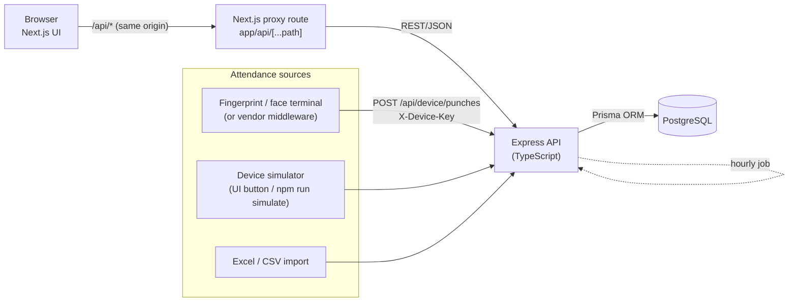
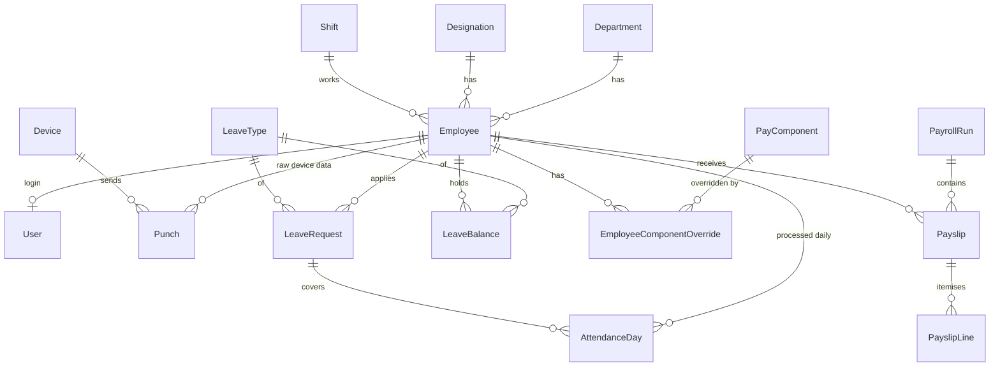
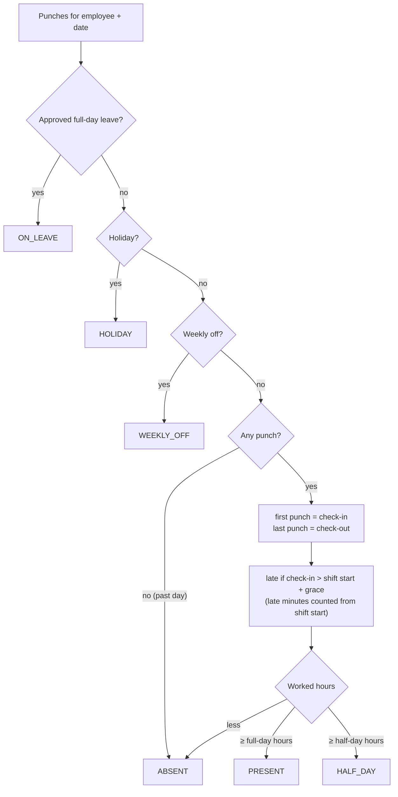

# Architecture & Module Guide

This document explains how the system is put together. Use it to present the project.

## 1. High-level architecture

- **Three tiers**: a React/Next.js presentation layer, an Express REST API with the business rules, and PostgreSQL for storage.
- The browser only talks to the web app. A small **proxy route** forwards `/api/*` to the API, which keeps the login cookie first-party and lets Docker/Kubernetes set the API address at runtime.
- **Devices are separate clients.** They log in with a per-device API key, not a user password.
- An **hourly background job** in the API re-processes yesterday and today, so employees who never punch in are marked absent.

## 2. Backend modules (`api/src/modules`)

| Module | Responsibility | Key files |
|---|---|---|
| `auth` | Login and logout (JWT in an httpOnly cookie), current user, change password, rate-limited login | `auth.routes.ts`, `middleware/auth.ts` |
| `employees` | Employee master CRUD, deactivate/activate, password reset, per-employee pay overrides | `employees.routes.ts` |
| `attendance` | Punch ingestion, daily processing, manual correction, simulator, Excel/CSV import, device endpoint | `attendance.service.ts`, `rules.ts`, `simulator.ts`, `import.ts`, `device.routes.ts` |
| `leave` | Apply, approve, reject, cancel; balances, yearly allocation with carry-forward | `leave.service.ts` |
| `payroll` | Monthly processing, the country-agnostic **payroll engine**, payslip PDFs, register export | `engine.ts`, `payroll.service.ts`, `payslip-pdf.ts` |
| `reports` | HR dashboard, attendance summary, late report, leave summary, employee dashboard | `reports.routes.ts` |
| `settings` | Company rules, shifts, holidays, leave types, pay components, departments, designations, devices, audit log | `settings.routes.ts` |

Every module follows the same pattern: **route → Zod validation → service/Prisma → JSON**. Errors are thrown as `AppError` and turned into clean JSON by one error handler (`lib/errors.ts`). Important changes are written to the `AuditLog` table.

### Role-based access

| Role | Can do |
|---|---|
| **ADMIN** | Everything, including Settings (rules, pay components, devices) and creating HR/Admin users |
| **HR** | Employees, attendance, imports, leave approvals, payroll, reports |
| **EMPLOYEE** | Own dashboard, own attendance, apply for and withdraw leave, own **finalized** payslips |

The API enforces these rules with the `requireHR`/`requireAdmin` middleware. The UI hides menus as a convenience, but the API is the real gate.

## 3. Data model

Key design decisions:

1. **Raw punches and processed attendance are separate.** `Punch` stores exactly what a device, the simulator or an import sent. `AttendanceDay` is derived from it, so any source can be re-processed safely. Duplicate punches are ignored by a unique key on (employee, timestamp).
2. **Rules are data.** `CompanySettings`, `Shift`, `Holiday`, `LeaveType` and `PayComponent` hold everything a country or company might change, so there are no code changes per customer.
3. **Payslips are snapshots.** A payslip copies the employee name, department, salary and every calculated line. A **finalized** run is locked, so later edits to employees or rules never change history.
4. **Manual corrections win.** HR edits set `isManual`, and re-processing never overwrites them (they can be undone).
5. **Soft delete for employees.** Deactivation sets status and exit date and disables the login, while history stays.

## 4. Attendance processing

The rules live in `api/src/modules/attendance/rules.ts` as pure functions with unit tests. Times are interpreted in the company timezone from Settings. Punches from every source are merged, so the earliest punch of the day is the check-in and the latest is the check-out.

## 5. Payroll engine (country-agnostic)

The engine (`api/src/modules/payroll/engine.ts`) is a pure function: **inputs in, payslip lines out**, with no database access. That makes it easy to test and to explain.

Each **pay component** is one of:

| Calculation | Example |
|---|---|
| `FIXED` | Transport allowance 1,600 |
| `PERCENTAGE` of the sum of base codes, with an optional base cap | Retirement fund 12% of BASIC, base capped at 15,000 |
| `SLAB` – `PROGRESSIVE` (tax brackets) or `FLAT` (banded amount), monthly or annual | Income tax 0/5/10/15/20/30%, professional tax 0/150/200 |

It can also have min/max amounts and an **"apply only if gross is between X and Y"** condition (for example, health insurance only for low earners). Base codes can be `BASE_SALARY`, `GROSS` (earned gross) or any earlier component.

**Calculation order for one employee and month**

1. Summarise attendance: present, paid leave, unpaid leave, absent, days not employed (mid-month joiners or leavers), late count and late minutes.
2. **Loss-of-pay (LOP) days** = absent + unpaid leave + days not employed.
3. Earnings at full value (by sequence).
4. **Per-day pay** = prorated earnings ÷ divisor days (calendar days, working days, or a fixed number, from Settings).
5. **LOP deduction** = per-day pay × LOP days.
6. **Late deduction**, using the company rule: *none*, *every N late marks = X days*, or *per minute* (per-day pay ÷ shift minutes × late minutes).
7. Earned values = earnings reduced proportionally. **Statutory deductions and employer contributions are calculated on earned values**, so a short month also lowers tax and contributions.
8. Net pay = gross earnings − all deductions. Employer contributions are shown separately and are not deducted.

**Worked example (from the sample data):** base salary 171,000, 30-day divisor, so 5,700 per day. 1.5 absent days gives LOP 8,550. 5 late marks with "3 lates = ½ day" gives a 2,850 late deduction. Income tax is calculated on the annualised earned gross with progressive slabs.

## 6. Biometric integration

- Real terminals (ZKTeco, eSSL, Suprema, and others) or their vendor sync software call `POST /api/device/punches` with `X-Device-Key`. The payload is a list of `{ userId, timestamp }`, where `userId` is the employee's **biometric ID** or employee code.
- Device keys are stored only as SHA-256 hashes. The raw key is shown once when the device is registered and can be rotated.
- Without hardware, use **Attendance → Simulate device feed** (server-side generator) or `npm run simulate` (a stand-alone client that behaves exactly like a device).

## 7. Security measures

- Passwords hashed with bcrypt. Login is rate-limited. JWTs live in an httpOnly, SameSite=Lax cookie (set `COOKIE_SECURE=true` behind HTTPS).
- All input validated with Zod. Prisma parameterises every query (no SQL injection).
- `helmet` security headers. CORS is limited to the web origin.
- Role checks on every route. Employees can only read their own records.
- Audit log for settings changes, salary overrides, manual attendance, leave decisions and payroll actions.

## 8. Testing

- `api/tests/payroll-engine.test.ts`: LOP, late rules, caps, gross conditions, employer contributions, progressive annual tax, slabs.
- `api/tests/attendance-rules.test.ts`: present, late, half day, absent, leave and holiday priority, monthly summary, late penalty.

Run them with `cd api && npm test`.

## 9. Known limitations and possible extensions

- Shifts that cross midnight are grouped by calendar date of the punch. Night-shift support would need shift-anchored grouping.
- One-level approval (HR). A manager approval step could be added to `LeaveRequest`.
- No overtime, loans/advances or arrears yet. Each would be a new pay component source.
- Email notifications (leave decisions, payslip published) are not included.
